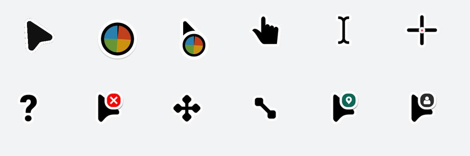

# Cursor-Type

一套风格统一的 Windows 鼠标指针主题：**Kimi 小箭头（青碧色）** 主光标 + **[Bibata Modern Classic](https://github.com/ful1e5/Bibata_Cursor)** 全套配套光标，一键安装、立即生效、无需管理员权限。



## 光标形态一览

普通箭头采用 KimiCU 同款箭头（当前为青碧色 `#14B8A6`，白色描边保留），其余角色使用 Bibata Modern Classic—— 同为深色填充 + 白色描边的圆角设计语言。

| 形态 | 预览 | 场景 |
|------|------|------|
| Normal（箭头） |  | 常规指针 |
| Busy（忙碌） |  | 程序无响应/加载中 |
| Working（后台忙碌） |  | 后台任务进行中 |
| Link（手型） |  | 悬停链接 |
| Text（I 型） |  | 文本输入 |
| Crosshair（十字） |  | 精确选择 |
| Help（帮助） |  | 帮助选择 |
| Unavailable（禁止） |  | 不可放置/不可用 |
| Move（移动） |  | 移动对象 |
| 缩放（四方向） |  | 调整窗口/对象大小 |
| Pin / Person |  | Windows 位置/联系人角色 |

> 箭头共收录 3 个颜色版本：青碧（当前默认 `kimi_arrow_teal.cur`）、黑色（`kimi_arrow_black.cur`）、蓝色（`kimi_arrow.cur`），可随时切换。

## 安装

克隆本仓库后，在仓库目录运行（普通用户权限即可）：

```powershell
powershell -NoProfile -ExecutionPolicy Bypass -File .\install.ps1
```

脚本会：

1. 把光标文件复制到 `%USERPROFILE%\Cursors`
2. 写入 `HKCU\Control Panel\Cursors` 的全部 17 个角色
3. 调用 `SystemParametersInfo(SPI_SETCURSORS)` 让新光标**立即生效**，无需重启

## 开机自动应用（可选）

Windows 更新或主题同步有时会把指针配置重置回默认。运行一次：

```powershell
powershell -NoProfile -ExecutionPolicy Bypass -File .\install-autostart.ps1
```

即可注册登录计划任务 `CursorType-Apply`，每次登录自动重应用本主题。移除用 `uninstall-autostart.ps1`。

## 辅助功能大小滑块防护（EoA 守护）

**问题根因**：设置 → 辅助功能 → 鼠标指针和触控 → 大小 这个滑块不走普通光标方案。每次拖动，Windows 都会用内置 aero 源在 `%LocalAppData%\Microsoft\Windows\Cursors\` 重新生成 17 个 `*_eoa.cur`，并把 `HKCU\Control Panel\Cursors` 全部重定向过去——主题瞬间被顶掉。

**解决方案**（v2.2.0 起，随 `install.ps1` 自动启用）：

1. `make_eoa.py` 预先把全部 17 个 eoa 光标烘焙成主题版（`cursors/eoa/`，48/72/96/144/192 五档尺寸，与系统生成的结构一致；箭头由矢量源渲染，动画角色取代表帧）
2. 安装时若 eoa 目录已存在，立即用主题版覆盖
3. 登录自启守护任务 `CursorType-EoaWatch`（`watch-eoa.ps1`）：监听 eoa 目录 + 每 3 秒自检注册表，一旦发现滑块重建了 eoa 或方案被重置，自动覆盖回主题版

效果：**随便拖大小滑块，主题都不再失效**，且滑块调大小依然有效（系统按档位从烘焙尺寸中取图）。守护进程几乎不占用资源（3 秒一次注册表读取 + 空闲的文件系统监听）。

## 覆盖范围说明

本主题覆盖 Windows 系统方案的全部 17 个指针角色。凡是使用系统标准光标的应用（资源管理器、绝大多数桌面软件、浏览器中的标准指针/手型/I 型等）都会自动跟随本主题。少数第三方软件（游戏、部分专业软件）打包并加载自己的光标文件，这类场景不受任何系统主题控制，需要按软件单独处理。

## 卸载 / 还原

```powershell
powershell -NoProfile -ExecutionPolicy Bypass -File .\uninstall.ps1
```

或在 **设置 → 蓝牙和设备 → 鼠标 → 其他鼠标设置 → 指针** 中把方案改回系统方案。光标文件会保留在 `%USERPROFILE%\Cursors`，可手动删除。

## 自定义

| 需求 | 做法 |
|------|------|
| 换回黑色箭头 | 把 `install.ps1` 中 `Arrow` 映射改为 `kimi_arrow_black.cur`，重新运行 |
| 换回蓝色箭头 | 把 `Arrow` 改为 `kimi_arrow.cur`，重新运行 |
| 完全统一为 Bibata | 把 `Arrow` 改为 `bibata\Pointer.cur` |
| 调整指针大小 | 设置 → 辅助功能 → 鼠标指针和触控 → 大小（v2.2.0 起随便拖，主题不丢） |

## 目录结构

```
cursors/
├── kimi_arrow_teal.cur    # 主光标：Kimi 箭头（青碧色，当前默认）
├── kimi_arrow_black.cur   # 主光标备选：Kimi 箭头（黑色）
├── kimi_arrow.cur         # 主光标备选：Kimi 箭头（蓝色，原版）
├── kimi_arrow.svg         # 主箭头矢量源（改色 / 二次创作用）
├── bibata/                # Bibata Modern Classic 全套（.cur + .ani，矢量管线渲染）
└── eoa/                   # 主题版辅助功能光标（17 个 *_eoa.cur，make_eoa.py 生成）
docs/previews/             # README 预览图（由 make_previews.py 生成）
install.ps1                # 一键安装（含 eoa 覆盖 + EoA 守护任务注册）
uninstall.ps1              # 还原默认
install-autostart.ps1      # 注册登录自动应用任务（可选）
uninstall-autostart.ps1    # 移除自动应用任务
watch-eoa.ps1              # EoA 守护进程（安装时复制到 %USERPROFILE%\Cursors）
make_eoa.py                # 生成主题版 eoa 光标
make_previews.py           # 从 .cur/.ani 提取预览图
```

## 版本

当前版本：**v2.2.0**（见 [CHANGELOG](CHANGELOG.md) 与 Releases）

## 致谢与许可

- 配套光标来自 [Bibata_Cursor](https://github.com/ful1e5/Bibata_Cursor)（GPL-3.0），感谢作者 [@ful1e5](https://github.com/ful1e5)
- Kimi 箭头提取自 KimiCU 的本地资源，仅作个人桌面美化用途
- 本仓库整体以 [GPL-3.0](LICENSE) 发布
